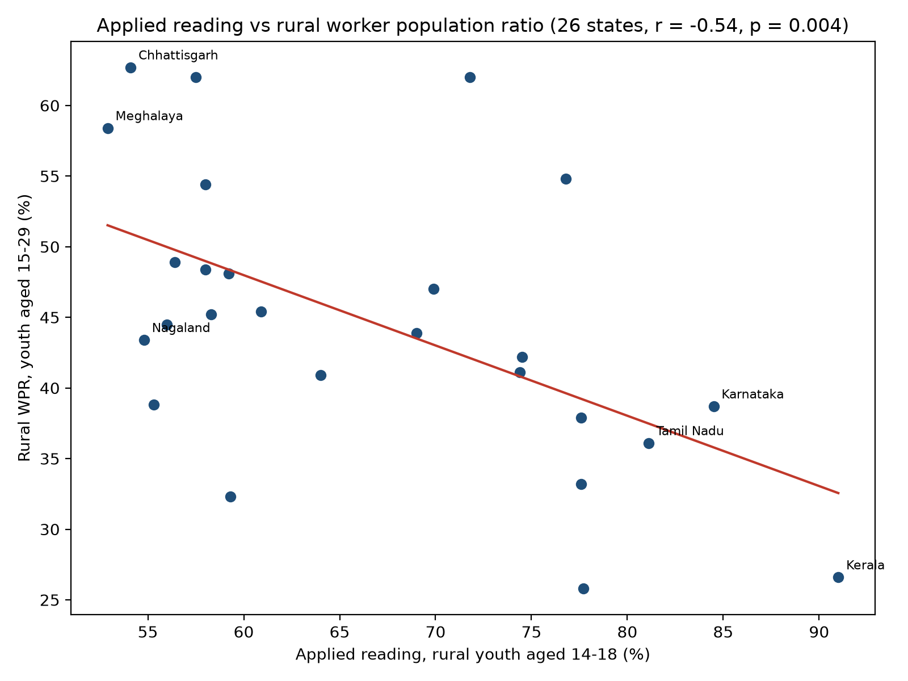
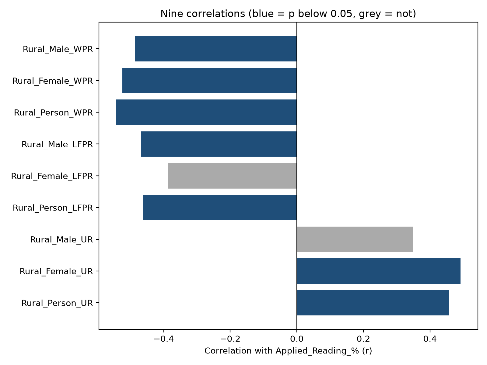

# Is applied reading associated with youth employment in rural India?

A state-level analysis of 26 Indian states, comparing ASER 2023 (Beyond Basics) learning data with PLFS 2023-24 youth labour market data.

## Research question

Across 26 states, is applied reading skill of rural youth associated with WPR of PLFS alongside LFPR and UR, keeping in mind that ASER covers youth aged 14-18 and PLFS covers youth aged 15-29?

This is a single-time-point comparison across states. It can show whether states with higher foundational skills currently have higher or lower youth employment rates. It cannot show cause, and it does not evaluate any policy.

## Main finding

States where more rural teenagers can read and understand written instructions tend to have **lower** rural youth employment (WPR), and **higher** rural youth unemployment.

| Outcome | Male r (p) | Female r (p) | Person r (p) |
|---|---|---|---|
| WPR | -0.487 (0.012) | -0.524 (0.006) | **-0.543 (0.004)** |
| LFPR | -0.467 (0.016) | -0.386 (0.051) | -0.462 (0.018) |
| UR | +0.348 (0.082) | +0.492 (0.011) | +0.458 (0.019) |

- Main result: applied reading vs rural person WPR, r = -0.543, p = 0.004, n = 26. It is the only one of the nine correlations that clears the stricter cutoff for nine tests (0.05 / 9 = 0.0056).
- Dropping one state at a time keeps the main correlation between -0.454 and -0.618. Without Kerala (the most influential state, n = 25) it is r = -0.454, p = 0.022.
- Seven of the nine correlations are below p = 0.05. Female LFPR (p = 0.051) is borderline and male UR (p = 0.082) is not distinguishable from chance at the usual line.
- Applied reading is associated with about 29% of the variation in WPR between states (R² = 0.294).

## Data

- **ASER 2023 Beyond Basics:** rural youth aged 14-18, 28 districts in 26 states. Applied reading is the share of youth who could read written instructions and answer at least 3 of 4 questions correctly. The task was only given to youth who could read at least a Std I text.
- **PLFS 2023-24, Tables 16-18:** LFPR, WPR and UR for rural youth aged 15-29, by male, female and person.
- **Two-district states:** Madhya Pradesh (Bhopal, Jabalpur) and Uttar Pradesh (Hathras, Varanasi) each had two ASER districts. Their values were combined into one state value, weighted by the number of youth surveyed, and rounded to one decimal.

## Method

1. Extracted the ASER and PLFS tables from the PDF reports and cleaned them in Python (pandas).
2. Merged them into one table with one row per state (`final_merged_data.csv`).
3. Ran nine Pearson correlations between applied reading and the rural WPR, LFPR and UR columns (male, female, person) using `scipy.stats.pearsonr`.
4. Checked robustness by dropping one state at a time.

## Limitations

- One district stands in for each state (two for Madhya Pradesh and Uttar Pradesh).
- ASER covers ages 14-18 and PLFS covers ages 15-29, so the two sources do not describe the same group.
- Only 26 states, so a few unusual states can move a correlation.
- ASER reports no margins of error.
- It is not clear from the report whether the applied reading percentage is out of all surveyed youth or only those who took the task.
- ASER's enrolment tables are pooled across districts, so they cannot be used by state.
- The nine correlations are not independent, since WPR, LFPR and UR are built from the same counts.

## Files

| File | What it is |
|---|---|
| [research_paper_clean.docx](research_paper_clean.docx) | The write-up |
| [final_merged_data.csv](final_merged_data.csv) | Merged state-level dataset (26 rows) |
| [chart1_scatter_wpr.png](chart1_scatter_wpr.png) | Figure 1: applied reading vs rural person WPR |
| [chart2_all_correlations.png](chart2_all_correlations.png)| Figure 2: all nine correlations |
| [Untitled-1.py](Untitled-1.py), [ASER_DATA_CODE.py](ASER_DATA_CODE.py) | Extraction, merging and correlation code |
| [Phase1_Research_Journal_Saiyami.docx](Phase1_Research_Journal_Saiyami.docx)| Research Journal phase 1|
|[Phase2_Research_Journal_Saiyami.docx](Phase2_Research_Journal_Saiyami.docx)|Research Journal phase 2|
| [phase_3_4_and_5.docx](phase_3_4_and_5.docx) |Research journal phase 3 to 5 |

## Author

Saiyami Jain, B.Sc. Economics, Mathematics, Statistics, St. Joseph's University, Bangalore
